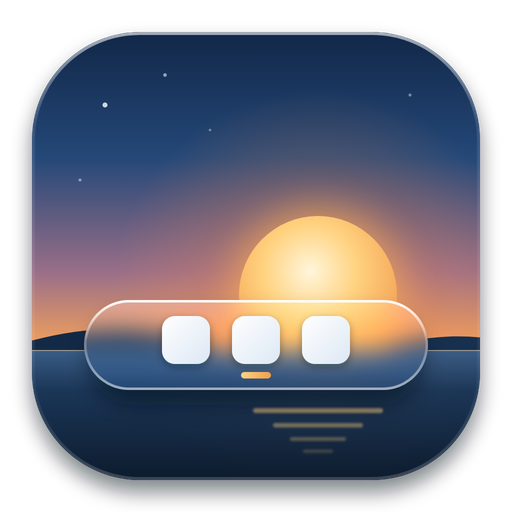

<p align="center">
  
</p>

<h1 align="center">Vitrobar</h1>

<p align="center">
  <b>A glass taskbar for Windows 11.</b><br>
  Apps, Start, quick settings, calendar and widgets, with a tiny resource footprint.
</p>

<p align="center">
  <a href="https://github.com/Giovix92/vitrobar/releases/latest"></a>
  <a href="https://github.com/Giovix92/vitrobar/releases"></a>
  
  
  <a href="LICENSE"></a>
</p>

<p align="center">
  <a href="https://giovix92.com/vitrobar/">Website</a> ·
  <a href="https://github.com/Giovix92/vitrobar/releases/latest">Download</a> ·
  <a href="CONTRIBUTING.md">Contribute</a>
</p>

---

## ✨ Why Vitrobar

A free, open-source replacement for the stock Windows 11 taskbar. Frosted glass, fast, and fully yours to tweak. Written in Rust, available for **x64** and **ARM64**.

> **Status:** pre-alpha. Expect rough edges, and please report them.

## 🚀 Highlights

| | |
|---|---|
| 🪟 **Glass taskbar** | Pinned and running apps with window dots, thumbnail strip on hover, tray with overflow, clock and right-click menus. |
| 🎨 **Make it yours** | Bar shape, material, icon size, top or bottom position, theme and accent colour. One bar per monitor. |
| 🔎 **Its own Start** | Pinned apps, recent files, *All apps*, search over apps, Settings pages and files, a built-in calculator and a power menu. A full-screen grid is available too. |
| ⚡ **Quick panel** | Volume and output device, brightness, Wi-Fi, Bluetooth, battery and power mode. |
| 📅 **Calendar panel** | On the clock, with a shortcut to the Windows notification centre. Input-language indicator when you use more than one layout. |
| 🎵 **Optional widgets** | Now-playing music pill (play, pause, skip) and your Claude 5-hour and weekly limits. Both off by default. |
| 🛟 **Safety net** | A watchdog gives the stock taskbar back if the bar crashes or exits. |

<details>
<summary><b>⌨️ Keyboard shortcuts</b></summary>

- **Win** opens Vitrobar's Start.
- **Win + 1…9** acts on the bar's apps.
- **Win + T** / **Win + B** move a focus ring over the apps and the tray.
- Every other Windows shortcut stays as it is.

</details>

<details>
<summary><b>🌍 Settings and languages</b></summary>

A settings window covers look, behaviour and language (English and Italian), and changes apply live.

</details>

## 📦 Install

1. Grab the zip for your machine from the [latest release](https://github.com/Giovix92/vitrobar/releases/latest) (`x64` or `arm64`).
2. Extract it and run `vitrobar.exe`.
3. Optional: enable *Start with Windows* from the first-run prompt or the settings.

Each download comes with a `.sha256` file so you can verify it.

## 🛠️ Build and test

```powershell
cargo build --release
cargo fmt --check
cargo clippy --workspace --all-targets -- -D warnings
cargo test --workspace
cargo build --release --target aarch64-pc-windows-msvc
pwsh scripts/perf-check.ps1 -Exe target/release/vitrobar.exe -MeasureStartup
pwsh scripts/perf-check.ps1 -Exe target/release/vitrobar.exe -StartPanel
```

Manual checks before a release are in [`docs/release-checklist.md`](docs/release-checklist.md).

## 🎨 Artwork

The logo is original: a dusk lake on a rounded tile, with the sun setting behind a frosted glass bar holding three app tiles. Sources are `assets/logo.svg` and `assets/logo-small.svg`, drawn from plain shapes and gradients with no third-party images, fonts or logos. Icons and favicons are rendered from them.

## 📄 License

[GPL-3.0](LICENSE), logo included.
